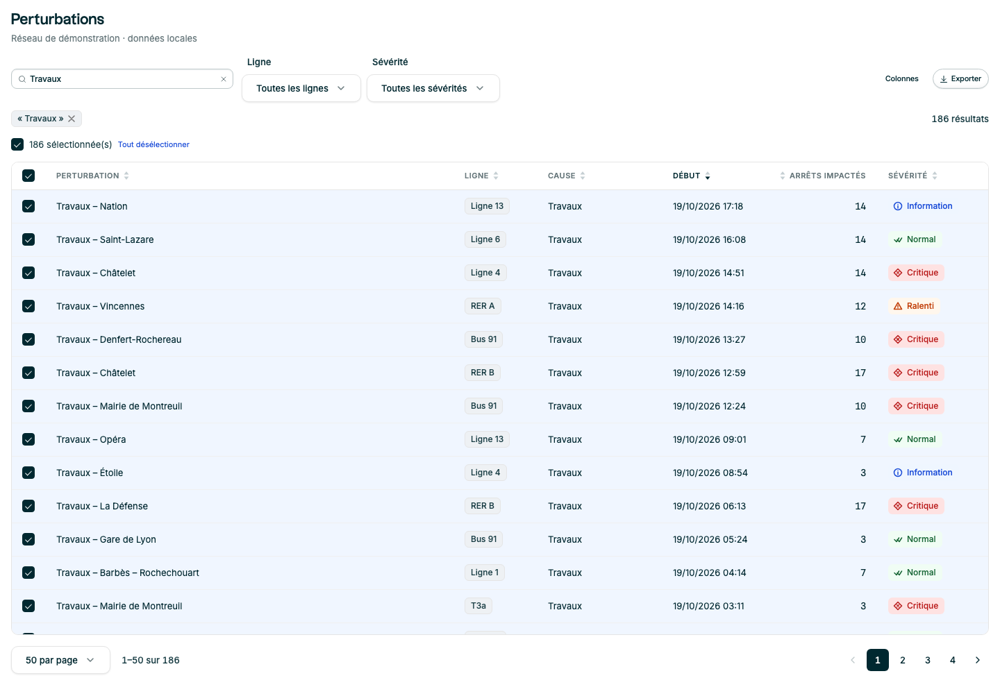
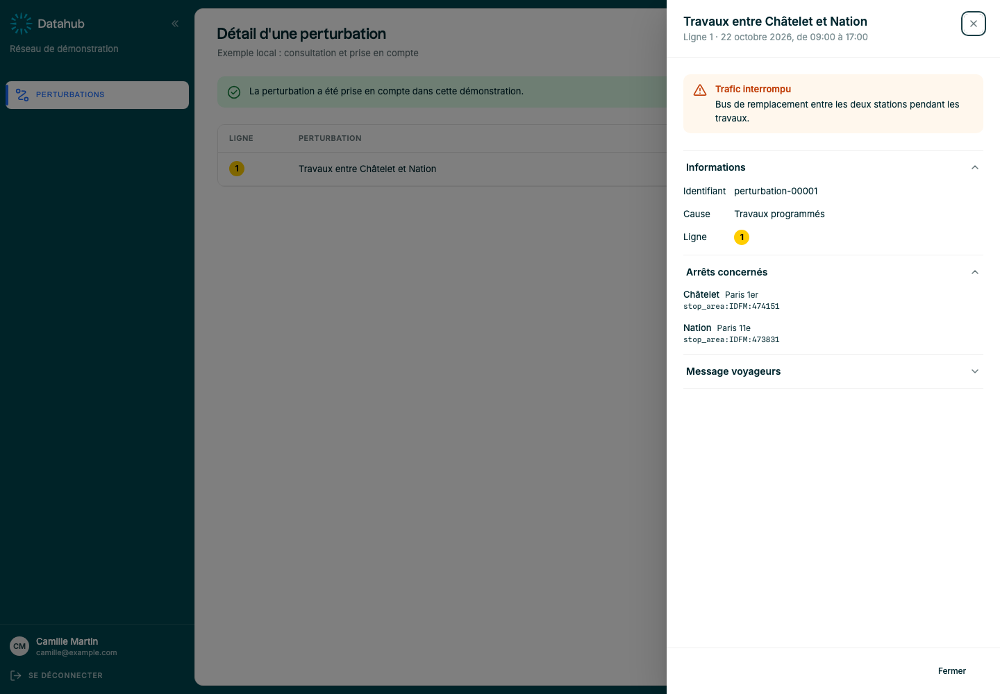
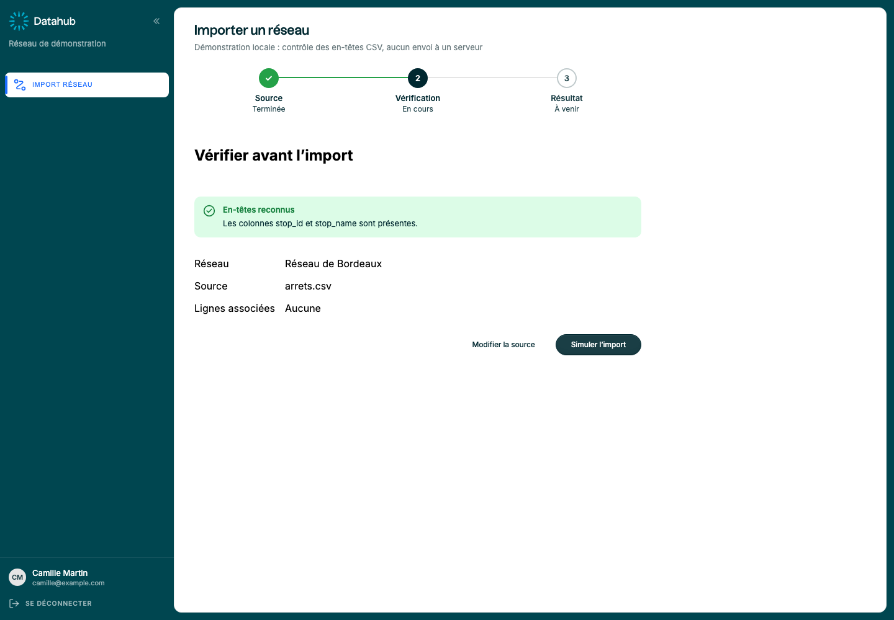
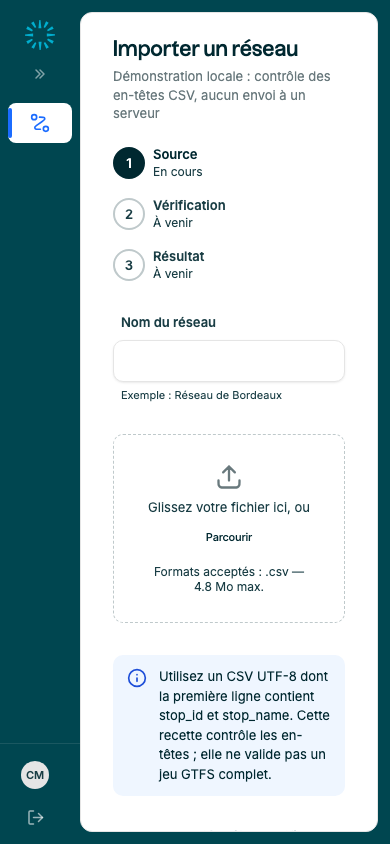

# Audit du lot « Composants additionnels » — 22 octobre 2026

## Périmètre et état de départ

Audit et corrections réalisés sur la branche existante `feat/additional-components`, en conservant les changements locaux déjà présents. Aucune publication, modification de version ou mise en production.

Le lot contenait dix composants, leurs styles et stories, des extensions de `DataTable`/`AlertToast` et une extraction de la primitive de menu. Ces fichiers étaient en grande partie non suivis par Git ; leur présence ne signifiait pas qu'ils étaient livrés. La proposition portait encore le statut « en attente » et les dix API manquaient aux guidelines.

État de référence : 253 tests unitaires et 353 tests de stories passaient. Les scénarios absents (rejet réel d'un fichier, ordre partiel des colonnes, menu entièrement désactivé, ouverture d'une modale depuis le menu, parcours d'import) ont révélé des problèmes supplémentaires.

## Constats et corrections

| Sujet | Problème observé à la lecture ou reproduit en test | Correction |
|---|---|---|
| `ColumnManager` | Un ordre partiel masquait des colonnes du panneau ; doublons possibles | Normalisation : ids connus uniques, colonnes manquantes ajoutées à la fin |
| `ColumnManager` | Focus resté sur le déclencheur ; Échap peu utile au clavier | Focus à l'ouverture, sortie Tab/Maj+Tab aux extrémités, Échap et retour au bouton |
| Menus/panneau de colonnes | Débordement vertical possible ; scroll interne fermait le panneau | Taille bornée au viewport, repositionnement et scroll interne conservé |
| `ActionMenu` partagé | Flèche haut ouvrait sur le premier item ; menu entièrement désactivé sans focus exploitable ; focus potentiellement rendu après ouverture d'une modale | Ouverture sur le dernier item avec ↑, focus du menu sans item actif, garde à la sélection, retour au déclencheur avant callback |
| `ExportMenu` | Les options « CSV » n'étaient pas reliées à leur portée ; export possible pour page/résultat vides | Descriptions accessibles par section, désactivation de toute portée vide ou en chargement |
| `Accordion` | Plusieurs `defaultOpen` contournaient le mode single au montage | Premier défaut uniquement en single ; test de régression |
| `FileUpload` | Jokers MIME et extensions composées non reconnus ; `maxSize=0` ignoré | Validation corrigée, tests unitaires des limites |
| `FileUpload` | Succès/attente seulement signalés par icône/couleur ; absence de progression traitée comme 0 | Libellés d'état, barre indéterminée sans valeur ; input natif hors tabulation, bouton visible conservé |
| `FileUpload` | `role="alert"` directement sur `<ul>` invalidait la sémantique de liste (axe) | Région d'alerte contenant une vraie liste |
| `ProgressBar` | Pas de nom accessible sans label ; NaN transmis aux attributs numériques | Nom de repli et mode indéterminé pour valeur non finie |
| `LineBadge` | Les couleurs GTFS sans dièse ne s'appliquaient pas ; blanc/encre insuffisants sur certains gris | Normalisation hex, repli noir dans l'intervalle où nécessaire ; les couleurs explicites restent sous responsabilité de l'app |
| `Gauge` | Même libellé de seuil des deux côtés : succès/échec indiqué seulement par la couleur ; jaune peu contrasté | État d'objectif écrit/annoncé, chiffres français, couleur d'avertissement issue du token de statut, limites non finies et mouvement réduit |
| `Stepper` | Étapes terminées/en erreur annoncées sans leur état ; largeur insuffisante sur petit écran | États textuels et empilement à 480px |
| `StopLabel` | Ellipse sur un conteneur flex sans cible propre au nom | Sous-élément du nom tronquable ; retour à la ligne des badges sur petit écran |
| `Checkbox` | Espace pouvait activer la case et faire défiler la page | `preventDefault` sur l'activation clavier |
| `TextInput` | Focus effaçait visuellement et sémantiquement une erreur métier ; contraste d'aide 3,21:1 sur blanc (axe) | Erreur/succès conservés pendant le focus, état disabled prioritaire ; aide et succès sur tokens contrastés |
| Documentation | README Vite, API du lot absentes et proposition obsolète | README projet, dix fiches API, table des intentions, règles de domaine, recettes, changelog et statut synchronisés |

## Trois compositions de référence

### Supervision des perturbations

`src/stories/ListeDePerturbations.stories.tsx` : filtres libellés, recherche temporisée, tri, pagination, sélection, `ColumnManager`, `ExportMenu` et `EmptyState`.

L'export CSV est réellement téléchargé : colonnes visibles dans leur ordre courant, page respectant le tri et portées sélection/page/résultat. La sélection exportée est l'intersection des ids sélectionnés avec le résultat filtré. Seul le format CSV est proposé, puisqu'aucun export Excel n'est implémenté dans cette recette. Les anciens boutons de démonstration « Dupliquer »/« Clôturer », sans comportement, ont été retirés.

### Détail d'une perturbation

`src/stories/ParcoursTransport.stories.tsx` : `AppLayout`, `Sidebar`, liste `DataTable`, `Drawer`, `InlineAlert`, `Accordion`, `LineBadge` et `StopLabel`. Une liste de définitions HTML suffit aux métadonnées. Prise en compte locale avec retour du focus à la liste.

### Import et correction d'erreurs

Même fichier : source CSV, nom de réseau, résumé d'erreurs focalisé et boutons vers les champs, `Autocomplete multiple` pour les lignes, vérification puis progression simulée et possibilité de recommencer. L'interaction de test soumet une source absente, un CSV invalide, puis une source valide.

Le fichier est lu localement ; seuls les en-têtes `stop_id`/`stop_name` sont contrôlés. Ce n'est ni un parseur CSV complet ni un validateur GTFS, et aucun envoi à un serveur n'est effectué. Les timers sont nettoyés au démontage.

## Choix de composants

- **Sélection multiple** : déjà couverte par `Autocomplete multiple` avec recherche et groupes. Aucun nouveau sélecteur ajouté. Une action de sélection globale pourra être ajoutée selon un besoin produit concret.
- **Résumé d'erreurs** : composition `InlineAlert` + `Link` + refs ; inutile de figer une nouvelle API à partir d'un seul exemple.
- **Liste de propriétés** : HTML `<dl>/<dt>/<dd>` dans les détails, même principe.
- **Historique et Timeline** : reportés jusqu'à disposer de données et d'interactions métier définies. La Timeline reste explicitement hors de ce lot.

## Écarts conservés par rapport à la proposition

- `StopLabel` emploie l'attribut natif `title`. `TooltipTrigger` ne peut pas envelopper un texte existant ; une infobulle Cadence pour texte tronqué nécessiterait une primitive distincte. Le texte complet reste dans le DOM.
- `LineBadge.mode` contribue au nom accessible, sans pictogramme de mode. Les couleurs explicites doivent être contrastées par l'app ; le calcul automatique couvre les hex valides.
- `Gauge` réutilise d3-shape et les tokens, sans `ChartFrame`. Chargement et erreur sont à composer autour de la jauge.
- La sidebar se replie manuellement : le contrôle mobile présenté ici utilise ce mode. Aucun système de navigation mobile automatique n'a été ajouté.
- La version du manifeste reste `0.5.0`. La cible `0.6.0` dans la proposition est une intention de livraison, pas une version publiée.

## Vérifications

Résultats après les derniers changements :

| Contrôle | Résultat |
|---|---|
| `npm test` | **616 tests réussis**, 85 fichiers (255 unitaires et 361 stories Chromium) |
| `npx tsc -b --noEmit` | Réussi |
| ESLint sur tous les fichiers TS/TSX modifiés dans ce travail | 0 erreur ; 1 avertissement préexistant `react-hooks/incompatible-library` sur TanStack Virtual dans `DataTable` |
| `npm run build:lib` | Réussi ; JS ESM/CommonJS, CSS et déclarations présents |
| Import ESM + chargement CommonJS | Les dix composants sont accessibles dans les deux formats |
| `npm run build-storybook` | Réussi ; avertissement de taille de chunks de documentation |
| `npm pack --dry-run --json` | 108 fichiers, environ 535 Ko compressés ; aucun fichier hors liste attendue |
| `git diff --check` | Réussi |

 Les nouvelles stories portent une vérification axe bloquante ; la configuration globale des anciennes stories reste `a11y.test="todo"`. Ces tests ne constituent pas une certification WCAG complète du catalogue.

Contrôles manuels automatisés dans Chromium :

- focus initial du panneau « Colonnes » sur « Réinitialiser » ;
- panneau de colonnes contenu dans une fenêtre 320×568 ;
- inspection des captures bureau 1440×1000 et mobile 390×844 après repli de la sidebar ;
- aucune largeur de document dépassant l'écran sur l'import mobile ;
- contrôle du contenu du CSV téléchargé : page de 50 résultats, ordre cohérent, colonne masquée absente.

## Suite proposée

Avant publication : choisir la version, relire les évolutions visuelles du lot dans Storybook et intégrer les changements de la branche selon le workflow du dépôt. Ne pas publier le `dist/` de l'app Vite : utiliser `build:lib`.

Les prochaines priorités dépassent ce lot : audit de contraste global des anciens composants, comportement des popovers à l'intérieur de surcouches modales, navigation mobile dédiée si les applications la requièrent, puis historique ou frise temporelle sur la base de cas métier réels.
