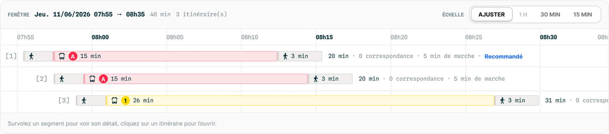

# Prompt — Timeline : horaires **et** itinéraires

> À lancer dans Claude Code, repo `/Users/ddao-ellena/hove-cadence-ui`.
> Lis d'abord `CLAUDE.md`, `GUIDELINES.md` (fiche `Timeline`, section dataviz, tokens) et `docs/HANDOFF.md`.
> Branche dédiée `feat/timeline-itineraires`. **Ne pousse rien et ne publie rien sur npm sans demande explicite.**

## Objectif

Faire évoluer `Timeline` pour couvrir deux usages, avec un design commun issu de la maquette jointe :

1. **Horaires et plages** (usage actuel) : perturbations, amplitudes de service, travaux. Une ligne par entité, des plages colorées par `tone` et doublées d'un motif.
2. **Itinéraires** (nouveau) : comparer plusieurs trajets sur une fenêtre de départ. Une ligne par itinéraire, chacune composée de **segments** (marche, transport, attente) et suivie d'un **résumé**.

Aucune rupture de l'API actuelle de `Timeline` : les stories existantes doivent rester vertes.

## Maquette (référence visuelle)

Fichier `docs/prompts/timeline-itineraires-maquette.webp` (à lire avec l'outil Read) : comparaison de 3 itinéraires, fenêtre « Jeu. 11/06/2026 07h55 → 08h35 ».

| Zone | Ce que montre la maquette |
|---|---|
| Bandeau haut | `FENÊTRE` (petites capitales, gris) + date et bornes en mono gras (`Jeu. 11/06/2026 07h55 → 08h35`) + méta en mono gris (`40 min`, `3 itinéraire(s)`). À droite : `ÉCHELLE` + sélecteur `Ajuster` / `1 h` (désactivé) / `30 min` / `15 min`. Fond `--cadence-color-surface-subtle`, filet bas. |
| Axe | **En haut**, format `08h15` en mono. Graduations toutes les 5 min, **quarts d'heure en gras**. Lignes verticales de grille sur toute la hauteur, plus marquées aux quarts d'heure. |
| Lignes | Libellé `[1]`, `[2]`, `[3]` en mono gris, **collé au début du trajet** (effet d'escalier, il suit l'heure de départ) au lieu d'une gouttière fixe. Séparateurs horizontaux entre lignes. |
| Segment marche | Rectangle gris clair bordé, picto piéton, durée (`3 min`) si la place le permet. |
| Segment transport | Rectangle teinté de la couleur de ligne (fond pâle + bordure de la couleur), picto du mode, `LineBadge` rond (`A`, `1`), durée (`15 min`). |
| Résumé | Après le dernier segment, en mono : `20 min · 0 correspondance · 5 min de marche`, plus une étiquette `Recommandé` (accent, gras) sur l'itinéraire mis en avant. |
| Débordement | La zone défile horizontalement : la ligne 3 et la dernière graduation sont coupées à droite. |
| Pied | Aide : « Survolez un segment pour voir son détail, cliquez sur un itinéraire pour l'ouvrir. » Fond discret, filet haut. |

## Phase 0 — audit, puis STOP

Ne code rien avant validation. Produis un court rapport :

1. **Architecture** : un seul composant `Timeline` avec une variante (`variant="journeys"` ou items typés `kind: "walk" | "transit" | "wait"`), ou un composant dédié `JourneyTimeline` qui partage des primitives avec `Timeline` (`timeline-utils.ts`, axe, grille, bandeau, échelle). Donne une recommandation argumentée : API lisible côté app, pas de props mortes selon l'usage, coût de maintenance.
2. **Rendu SVG ou HTML** : la maquette contient pictos, `LineBadge`, texte tronqué et défilement horizontal. Compare SVG (actuel) et HTML positionné en `%` ou en px selon l'échelle. Points à évaluer : accessibilité, focus, troncature du texte, export, réutilisation de `ChartFrame` / `ChartTooltip` / `ChartDataTable`.
3. **Échelle et zoom** : la fiche actuelle interdit le zoom. Proposer la règle : « Ajuster » = toute la fenêtre tient dans la largeur ; une échelle fixe = N px par minute avec défilement horizontal. Quand une échelle doit-elle être désactivée (le `1 h` de la maquette, sans doute parce que la fenêtre fait moins d'une heure) ?
4. **Manques du DS** à combler :
   - pictos marche et modes (bus, tram, métro, RER, train) : présents dans `@untitledui/icons` ? Sinon, que faire, sans URL distante ;
   - option désactivée dans `SegmentedControl` (prop `disabled` par option) ;
   - format d'heure `08h15` (helper fr-FR) à côté de `formatValue` ;
   - tokens : fond et bordure des segments marche, teinte pâle dérivée d'une couleur GTFS (calcul plutôt que token ? contraste du texte sur la teinte).
5. **Données** : proposer les types. Par exemple `JourneyRow { id; label; segments: JourneySegment[]; summary?; recommended? }` et `JourneySegment { id; kind; start; end; mode?; line?: { code; color?; textColor? }; label? }`. Le résumé est-il calculé par le composant (durée, correspondances, marche) ou fourni par l'app ?
6. **Interaction et a11y** : survol d'un segment → `ChartTooltip` (détail du segment) ; clic sur la ligne → `onJourneyClick`. Navigation au clavier (↑/↓ entre itinéraires, ←/→ entre segments, Entrée pour ouvrir), annonce `role="status"`, alternative « Voir les données » (une ligne par segment ou par itinéraire ?). Mise en avant « Recommandé » sans dépendre de la couleur seule.
7. **Impact sur l'usage horaires** : quels éléments du nouveau design s'appliquent aussi aux plages (bandeau, axe en haut, grille, échelle, mono, aide en pied) ? Risque de rupture visuelle pour les apps qui utilisent déjà `Timeline` 0.7.0 ?

Termine par la liste des fichiers touchés et un découpage en lots, puis **STOP** : attends ma validation.

## Lots indicatifs (après validation)

- **Lot A — fondations partagées** : helpers de temps (`08h15`, pas de graduation, quarts d'heure), grille et axe haut, bandeau de fenêtre, sélecteur d'échelle (option désactivée dans `SegmentedControl`), défilement horizontal, aide en pied. Appliqué à l'usage horaires.
- **Lot B — itinéraires** : segments marche, transport et attente, pictos, `LineBadge`, troncature, libellé `[n]` en escalier, résumé, « Recommandé », tooltip, clic, clavier, « Voir les données ».
- **Lot C — documentation** : fiche GUIDELINES (table « Intention → composant », props, ✅/❌, règle de zoom révisée), CHANGELOG 0.7.0, stories (Horaires, Itinéraires reproduisant la maquette, Échelles, Débordement, Vide, Erreur, Chargement, Clavier), recette éventuelle dans « Parcours transport ».

## Contraintes du design system (rappel)

- Couleurs, polices et rayons **uniquement via tokens** avec fallback (`var(--cadence-…, …)`). Les tests `css-tokens.test.ts` et `portability.test.ts` doivent rester verts. Mono via `--cadence-font-mono`.
- Couleur de ligne GTFS : seule exception aux tokens, comme `LineBadge`. Contraste AA du texte garanti (`line-badge-utils`).
- Jamais la couleur seule : les segments se distinguent aussi par picto et libellé ; « Recommandé » est un texte.
- Libellés FR accentués, commentaires en français, conventions de fichiers plats (`Foo.tsx`, `foo.css`, `Foo.stories.tsx`, export `index.ts`).
- `a11y: 'error'` global : aucune violation axe. `prefers-reduced-motion` respecté.
- Compatibilité React 18 et 19 (`npm run test:react18`).

## Vérification attendue à chaque lot

- `npx tsc -b --noEmit`, `npx eslint <fichiers touchés>`, `npx vitest run` (unit + storybook), `npm run build:lib`, `npm run smoke:dist`, `git diff --check`.
- Contrôle visuel dans Storybook de la story « Itinéraires » face à la maquette (captures), à 1280 px et en largeur réduite (défilement).
- Résumé final : commits, écarts assumés face à la maquette, points ouverts.
