# Boutons v2 — captures avant / après

Storybook local, Chromium, 900 × 640, thème clair. « avant » = `main` @ `5b8c199` (0.2.0), « après » = `feat/buttons-v2` (0.3.0).

| Écran | Avant | Après |
|---|---|---|
| Modal (destructive) | 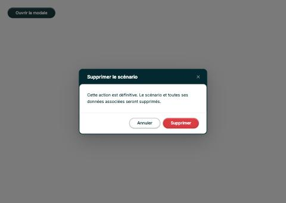 |  |
| AlertToast (actions) | 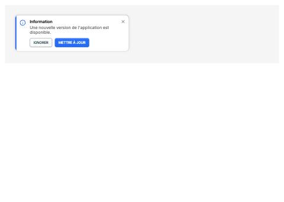 | 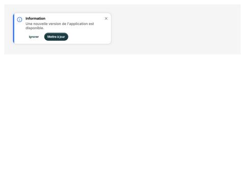 |
| FilterBar (complète) | 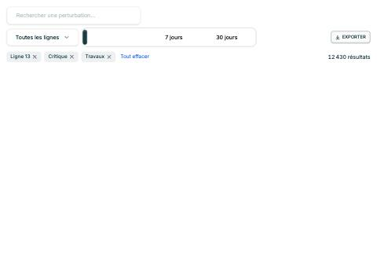 | 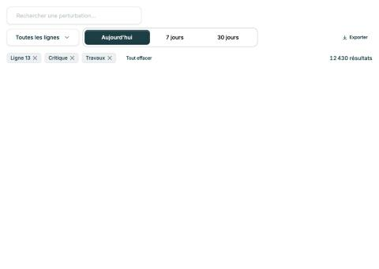 |
| DatePicker (avec heure) | 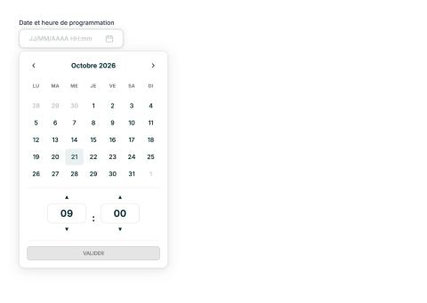 | 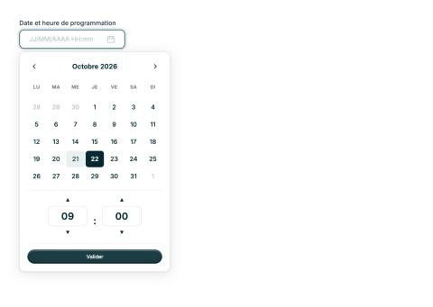 |
| DateRangePicker (un mois) | 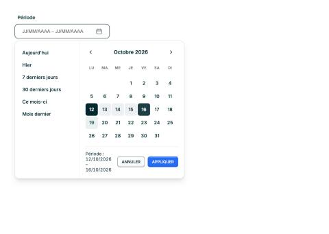 | 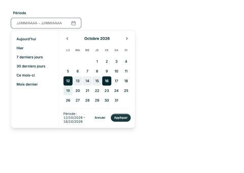 |
| Recette « Liste de perturbations » | 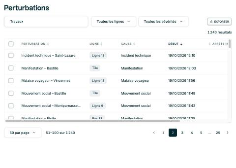 | 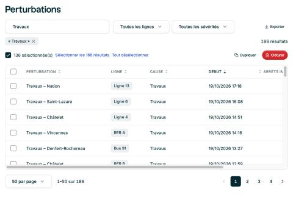 |

Matrice (story `Actions/Matrice`) : 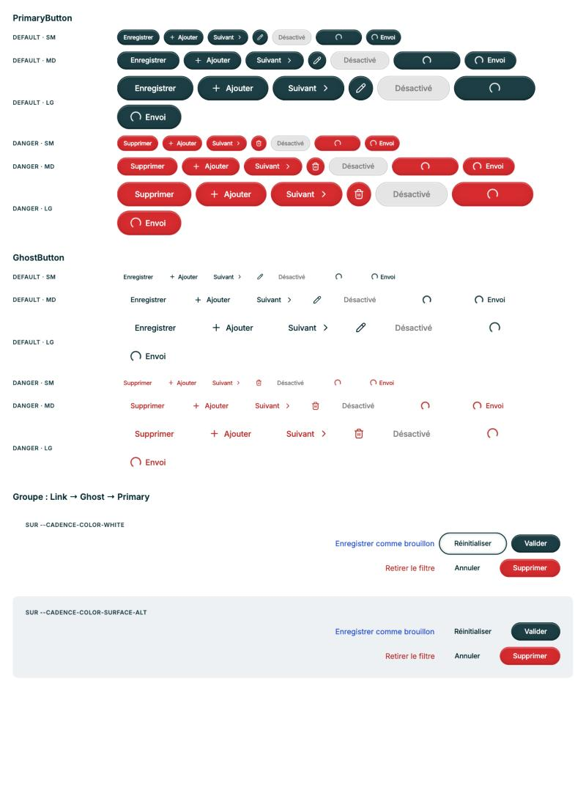
