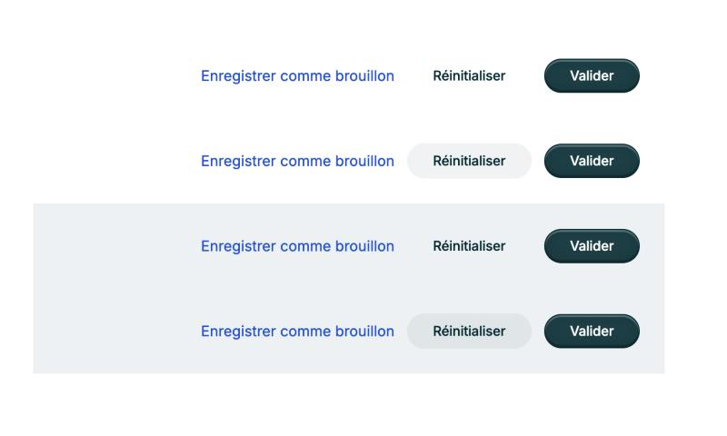

# Boutons v2 — `PrimaryButton` + `GhostButton`, `Link` en 3e action (phase 0)

> Statut : **validée (Q1 à Q9) et implémentée** sur `feat/buttons-v2`. Ajustements demandés après coup : voir la dernière section.
> Base : `main` @ `5b8c199` (v0.2.0), branche `feat/buttons-v2`. Cible : **0.3.0**, sans API cassée.
> Les mesures et contrastes ci-dessous viennent du rendu réel dans Storybook (Chromium), pas des CSS lus à la main.

Décisions rappelées (non rediscutées) :
- deux boutons, `PrimaryButton` (plein, un seul par vue) et `GhostButton` (sans fond ni bordure au repos) ;
- `Link hideArrow` en 3e action ;
- le bleu plein disparaît des actions : `SecondaryButton` est déprécié, et `--cadence-color-accent` est réservé aux états.

## Sommaire

1. [API commune](#1-api-commune)
2. [Tailles](#2-tailles)
3. [États × tons](#3-états--tons)
4. [`GhostButton` ou `Link hideArrow`](#4-ghostbutton-ou-link-hidearrow)
5. [Migration des usages internes](#5-migration-des-usages-internes)
6. [Compatibilité 0.3.0 et codemod](#6-compatibilité-030-et-codemod)
7. [Écrans au rendu modifié](#7-écrans-au-rendu-modifié)
8. [Questions à trancher](#8-questions-à-trancher)

---

## 1. API commune

Les deux composants ont **le même type de props**. Seul le rendu change. Ils partagent un composant interne non exporté (`BaseButton` + `base-button.css` pour le gabarit), et chacun a son `.css` pour les couleurs.

```ts
type ActionButtonBaseProps = {
  /** Ton sémantique. "danger" = action destructive. Défaut "default". */
  tone?: "default" | "danger";
  /** Gabarit. Défaut "md". Ne porte pas de sens : dépend du contexte (voir GUIDELINES). */
  size?: "sm" | "md" | "lg";
  /** Icône avant / après le libellé. */
  iconStart?: IconName;
  iconEnd?: IconName;
  /** En cours : clics ignorés, aria-busy, spinner, largeur conservée. */
  loading?: boolean;
  disabled?: boolean;
  /** Occupe toute la largeur du conteneur. */
  fullWidth?: boolean;
  /** Défaut "button" (jamais de soumission involontaire). */
  type?: "button" | "submit" | "reset";
  onClick?: React.MouseEventHandler<HTMLButtonElement>;
  className?: string;
};

export type ActionButtonProps = ActionButtonBaseProps &
  (
    | { label: string; icon?: never; "aria-label"?: string }
    | { icon: IconName; label?: never; "aria-label": string } // icône seule : aria-label obligatoire
  );

export type PrimaryButtonProps = ActionButtonProps; // + props héritées dépréciées (voir 6)
export type GhostButtonProps = ActionButtonProps;

export const PrimaryButton: React.ForwardRefExoticComponent<PrimaryButtonProps & React.RefAttributes<HTMLButtonElement>>;
export const GhostButton: React.ForwardRefExoticComponent<GhostButtonProps & React.RefAttributes<HTMLButtonElement>>;
```

**Comportement commun**
- `forwardRef` vers le `<button>`. Pas de prop `state` : survol, appui et focus passent par `:hover`, `:active` et `:focus-visible`. Il n'y a plus de `useState` ni de gestionnaires de souris.
- **Désactivé** : attribut natif `disabled`, donc pas de focus et pas de clic.
- **Chargement** : `aria-busy="true"` et `aria-disabled="true"`. Le bouton reste focusable, pour que le focus ne saute pas pendant une soumission. `onClick` n'est pas appelé.
  - Avec `iconStart`, le spinner prend la place de l'icône.
  - Sans icône, le libellé passe en `visibility: hidden` (la largeur est conservée) et le spinner est centré par-dessus.
  - En icône seule, le spinner remplace l'icône.
  - Le spinner suit `currentColor`, est `aria-hidden` et ne tourne pas avec `prefers-reduced-motion` (pulsation à la place).
- **Icône seule** : `aria-label` est exigé par le typage, et `Icons` est rendu sans `title` (décoratif). Le bouton est carré (voir 2).
- `label` et `icon` sont exclusifs au typage : `<GhostButton label="…" icon="…" />` ne compile pas.

---

## 2. Tailles

Les valeurs sont **reprises du rendu actuel**. Les deux composants ont **exactement les mêmes dimensions** : le `GhostButton` garde une bordure transparente de 1px pour s'aligner au pixel sur le `PrimaryButton` dans un groupe.

| | `sm` (= `SecondaryButton` medium) | `md` (= `PrimaryButton` medium, défaut) | `lg` (= `PrimaryButton` large) |
|---|---|---|---|
| Hauteur | 29px | 34px | 46px |
| Padding horizontal, sans icône | 11px | 24px | 32px |
| Padding horizontal, avec icône (côté icône / côté texte) | 9px / 10px | 18px / 20px | 24px / 28px |
| Texte | 11px / 500 / 13,2px, approche −0,22px | 13px / 500 / 15,6px, approche −0,13px | 15px / 500 / 18px, approche −0,15px |
| Icône | 12px | 16px | 20px |
| Écart icône–texte | 5px | 8px | 8px |
| Icône seule | 29 × 29 | 34 × 34 | 46 × 46 |
| Rayon | pilule (`999px`) | pilule | pilule |

- **Icône seule carrée** : aujourd'hui, `withIcon="only"` mesure 66 × 34 (md) et 62 × 29 (`SecondaryButton`). C'est un accident : le padding du texte est appliqué à l'icône. Le carré est le gabarit attendu (voir Q5).
- **Rayon pilule partout** : `SecondaryButton` avait un rayon de 6px. Comme il disparaît, `sm` prend la forme de la famille. Un groupe `sm` aligne alors deux pilules (voir Q4).

---

## 3. États × tons

### 3.1 `PrimaryButton`

| État | `tone="default"` | `tone="danger"` |
|---|---|---|
| Repos | fond `--cadence-color-label` (`#1a3e45`), bordure `--cadence-color-primary`, texte blanc **11,6:1**, relief interne (inchangé) | fond `--cadence-color-danger` (`#da1e28`), texte blanc **5,0:1** (voir Q2) |
| Survol | idem + ombre `--cadence-shadow-md` | fond **`--cadence-color-danger-hover`** (`#c91720`, nouveau token) **5,8:1** |
| Appui | fond `--cadence-color-primary` (`#002830`) **15,6:1** | fond **`--cadence-color-danger-active`** (`#b91c1c`, nouveau, = `status-critical-fg`) **6,5:1** |
| Focus clavier | `--cadence-focus-ring` (liseré blanc 2px + anneau `#1a3e45` 2px) | idem |
| Désactivé | fond `--cadence-color-border`, bordure `--cadence-color-border-strong`, texte `--cadence-color-text-disabled` (inchangé) | idem (le rouge pâle `#fbe8e9` / `#f6c7c9` disparaît) |
| Chargement | comme le repos, spinner blanc | idem |

Le repos de `PrimaryButton` **ne change pas** : fond `#1a3e45`, appui `#002830`. L'encre « plein » de la décision correspond déjà à ce rendu ; je ne fonce pas le repos pour ne pas changer tous les écrans.

### 3.2 `GhostButton`

| État | `tone="default"` | `tone="danger"` |
|---|---|---|
| Repos | fond transparent, bordure transparente, texte `--cadence-color-primary` — **15,6:1** sur blanc, **13,8:1** sur `surface-alt` | texte **`--cadence-color-danger-text`** (`#b91c1c`, nouveau) — **6,5:1** sur blanc, **5,7:1** sur `surface-alt` |
| Survol | fond **`--cadence-color-hover-overlay`** (`rgba(0, 40, 48, 0.06)`, nouveau) — texte 13,9:1 sur blanc, 12,3:1 sur `surface-alt` | fond **`--cadence-color-danger-hover-overlay`** (`rgba(218, 30, 40, 0.06)`) — 5,9:1 sur blanc, 5,2:1 sur `surface-alt` |
| Appui | fond **`--cadence-color-active-overlay`** (`rgba(0, 40, 48, 0.12)`) — texte 12,3:1 sur blanc, 10,9:1 sur `surface-alt` | `rgba(218, 30, 40, 0.12)` — 5,3:1 sur blanc, 4,75:1 sur `surface-alt` |
| Focus clavier | `--cadence-focus-ring`, **indispensable** sans bordure | idem |
| Désactivé | texte `--cadence-color-text-disabled`, sans fond (gabarit conservé) | idem |
| Chargement | spinner en `currentColor` | idem |

**Pourquoi des voiles translucides plutôt que `--cadence-color-surface-alt` au survol ?** Un Ghost posé sur un fond `surface-alt` (barre de sélection, carte, `TableCard`) aurait un survol **invisible** : 1,0:1 entre le fond et la surface. Un voile d'encre à 6 % assombrit d'un cran **n'importe quel fond**, blanc comme alterné. `DatePicker` utilise déjà ce principe (`rgba(0, 40, 48, 0.07)` au survol des jours). Voir Q3.

**Pourquoi `--cadence-color-danger-text` (`#b91c1c`) pour le texte danger ?** `--cadence-color-danger` (`#da1e28`) fait 5,0:1 sur blanc, mais **4,4:1 sur `surface-alt`** et **4,1:1 sur le fond critique** : il échoue au seuil AA dès que le fond n'est pas blanc. `#b91c1c` est déjà la valeur de `--cadence-status-critical-fg`.

### 3.3 Tokens

| Token | Valeur | Usage |
|---|---|---|
| `--cadence-color-danger-hover` | `#c91720` | Survol d'un `PrimaryButton tone="danger"` (ancienne valeur « appui » en dur) |
| `--cadence-color-danger-active` | `#b91c1c` | Appui d'un `PrimaryButton tone="danger"` |
| `--cadence-color-danger-text` | `#b91c1c` | Texte danger sur fond clair : `GhostButton tone="danger"`, `Link variant="destructive"` |
| `--cadence-color-hover-overlay` | `rgba(0, 40, 48, 0.06)` | Survol d'un élément sans fond (Ghost) |
| `--cadence-color-active-overlay` | `rgba(0, 40, 48, 0.12)` | Appui d'un élément sans fond |
| `--cadence-color-danger-hover-overlay` | `rgba(218, 30, 40, 0.06)` | Survol d'un Ghost danger |
| `--cadence-color-danger-active-overlay` | `rgba(218, 30, 40, 0.12)` | Appui d'un Ghost danger |
| `--cadence-color-link` | `#1d4ed8` | Texte de `Link` (voir 4 et Q1) |

**Supprimés des CSS** (valeurs en dur) : `#de353e`, `#c91720`, `#f6c7c9`, `#ed8e93`, `#fdf4f4`, `#fbe8e9` (`primary-button.css`) ; `#0f62fe`, `#dc2626`, `#b91c1c` (`link.css`) ; tout le bleu de `secondary-button.css`, qui n'est plus rendu.

Le relief interne de `PrimaryButton` (ombres `inset`) reste propre au composant, comme le prévoit déjà `tokens.css`. Il est écrit en `rgba()` : plus aucun hex dans `primary-button.css`, `ghost-button.css` et `link.css`.

---

## 4. `GhostButton` ou `Link hideArrow`

Prototype du groupe `Link` · `GhostButton` · `PrimaryButton` (taille `md`). De haut en bas : sur blanc, sur blanc avec le Ghost survolé, sur `surface-alt`, puis sur `surface-alt` avec le Ghost survolé.



**Lecture** : les trois niveaux se distinguent sans hésitation.
- **Link** : couleur (bleu), graisse 400, aucun gabarit, souligné au survol.
- **Ghost** : encre, graisse 500, et au survol une pilule de la même taille que le Primary.
- **Primary** : seul élément plein.

Je n'ajoute **pas de bordure** au Ghost. La seule zone de doute serait un Ghost isolé, hors groupe et sans icône, qui peut se lire comme un simple texte. La règle « un Ghost seul porte une icône ou se trouve à côté d'un Primary » le couvrira dans `GUIDELINES.md`.

**Ajustements de `Link`**
1. **Couleur** : `--cadence-color-accent` (`#1b6cff`) fait 4,5:1 sur blanc mais **4,0:1 sur `surface-alt`** (échec AA). Je propose un token **`--cadence-color-link: #1d4ed8`** (6,7:1 sur blanc, 5,9:1 sur `surface-alt`), plus sombre, de la même famille. `accent` reste réservé aux états, ce qui va dans le sens de la décision 3 (voir Q1).
2. **Pas de retour à la ligne** pour un `Link` rendu en `<button>` (sans `href`) : `white-space: nowrap`. Constat : dans un groupe flex, « Enregistrer comme brouillon » se coupe aujourd'hui sur **3 lignes** (72 × 60px mesurés). Un `Link` avec `href` (navigation dans un texte) garde le retour à la ligne normal.
3. **Focus** : `--cadence-focus-ring` à la place de l'`outline` en `currentColor` actuel.
4. **`variant="secondary"`** (aujourd'hui identique à `primary`) : je propose de le **fusionner** (alias déprécié de `primary`, avertissement en dev) plutôt que de lui inventer un sens, pour garder trois niveaux nets (voir Q7).
5. **`variant="destructive"`** : `--cadence-color-danger-text`, avec un survol `--cadence-color-danger-active`.

---

## 5. Migration des usages internes

| Composant | Aujourd'hui | Demain | Pourquoi |
|---|---|---|---|
| `Modal` (`secondaryAction`) | `PrimaryButton outline` | `GhostButton` (md) | Action secondaire du pied de modale |
| `Modal` (`primaryAction`) | `PrimaryButton`, `destructive` | `PrimaryButton` (md), `tone={destructive ? "danger" : "default"}` | Inchangé ; l'API `primaryAction.destructive` de `Modal` reste |
| `AlertToast` (`actions`, `outline` ou 1re action par défaut) | `SecondaryButton outline` | `GhostButton size="sm"` | Action secondaire |
| `AlertToast` (`actions`, action pleine) | `SecondaryButton` (bleu) | **`PrimaryButton size="sm"`** | C'est l'action principale du toast (« Annuler l'envoi », « Voir »). L'API `AlertToastAction.outline` reste |
| `DatePicker` (« Valider », `withTime`) | `SecondaryButton` (bleu), pleine largeur | **`PrimaryButton size="sm" fullWidth`** | Seule action du popover, qui valide la saisie |
| `DateRangePicker` (« Annuler ») | `SecondaryButton outline` | `GhostButton size="sm"` | Secondaire |
| `DateRangePicker` (« Appliquer ») | `SecondaryButton` (bleu) | **`PrimaryButton size="sm"`** | Action principale du popover |
| `FilterBar` (« Tout effacer ») | `Link hideArrow size="sm"` | **`GhostButton size="sm"`** | Ce n'est ni une 3e action de groupe ni une action dans un texte : c'est une action de la barre (voir Q6) |

Les **stories et MDX** concernés : `PrimaryButton`, `SecondaryButton`, `Modal`, `FilterBar`, `ListeDePerturbations`, `Tokens.mdx` et les guides `Buttons`, `Feedback`, `Forms`, `PageDashboard`, `PageFormulaire`. Ils passent par le codemod (phase 2), puis par une relecture des `// TODO buttons-v2`.

---

## 6. Compatibilité 0.3.0 et codemod

**Anciennes props de `PrimaryButton`**, toujours acceptées en 0.3.0 :

| Ancienne prop | Traduction | Avertissement (dev, une fois par prop) |
|---|---|---|
| `withIcon="left"` + `icon` | `iconStart` | « `withIcon` est déprécié : utilisez `iconStart` / `iconEnd` / `icon`. » |
| `withIcon="right"` + `icon` | `iconEnd` | idem |
| `withIcon="only"` + `icon` | `icon` + `aria-label`. Repli : `label`, sinon le nom de l'icône (« plus ») | idem, plus « `aria-label` manquant » si aucun libellé |
| `withIcon="no"` | rien | idem |
| `destructive` | `tone="danger"` | « `destructive` est déprécié : utilisez `tone="danger"`. » |
| `size="medium" \| "large"` | `"md" \| "lg"` | « `size="medium"` est déprécié : utilisez `"md"`. » |
| `state` | ignoré | « `state` est ignoré : survol et appui sont gérés en CSS. » |
| `outline` | rendu par `GhostButton` | « `outline` est déprécié : utilisez `GhostButton`. » |
| `iconMap` | ignoré (déjà déprécié) | — |
| `label` absent hors icône seule | `"Label"` (défaut historique) | « `label` manquant » |

- **`SecondaryButton`** devient une enveloppe `@deprecated` : `outline` → `GhostButton size="sm"`, plein → `PrimaryButton size="sm"`. Les autres props suivent le tableau ci-dessus. Un avertissement unique invite à migrer. Son `size="large"` (38px) correspond à `md` (34px), soit 4px de moins.
- **Avertissements** : `process.env.NODE_ENV !== "production"`. En mode bibliothèque, Vite **laisse** `process.env.NODE_ENV` dans le paquet : c'est le bundler de l'application (Vite, webpack, Next) qui le remplace, et l'avertissement disparaît en production. Un `Set` au niveau du module garantit un seul message par prop et par composant.
- **Codemod** `scripts/codemods/buttons-v2.mjs` :
  - basé sur l'**API du compilateur TypeScript** (`typescript` est déjà en `devDependencies`), avec des remplacements ciblés par position, ce qui préserve la mise en forme ; pas de nouvelle dépendance (voir Q8) ;
  - `PrimaryButton outline` → `GhostButton` ;
  - `SecondaryButton outline` → `GhostButton size="sm"` ;
  - `SecondaryButton` plein → `PrimaryButton size="sm"`, avec un **`// TODO buttons-v2`** (rôle à vérifier : principal ou secondaire ?) ;
  - `withIcon` / `icon` / `destructive` / `size` / `state` → nouvelles props ;
  - mise à jour des imports ;
  - options `--dry` et `--report`. Il est testé sur des fixtures (unitaires), puis passé sur les stories et MDX du dépôt.

---

## 7. Écrans au rendu modifié

Changements visuels attendus, et seulement ceux-là :
- **Bleu plein → encre** : « Valider » de `DatePicker` (avec heure), « Appliquer » de `DateRangePicker`, action pleine d'`AlertToast`, tous les `SecondaryButton` pleins des applications (via l'enveloppe).
- **Outline → ghost sans bordure** : pied de `Modal` (« Annuler »), « Annuler » de `DateRangePicker`, 1re action d'`AlertToast`, tous les `outline` des applications.
- **Rayon `sm`** : 6px → pilule pour les anciens `SecondaryButton` (Q4).
- **Icône seule carrée** (Q5).
- **`FilterBar`** : « Tout effacer » passe de lien bleu à Ghost `sm` (Q6).
- **`Link`** : `#0f62fe` → `#1d4ed8` (Q1), `#dc2626` → `#b91c1c`, plus de retour à la ligne pour les actions.
- **Danger plein** : `#de353e` → `#da1e28` (Q2, quasi imperceptible, corrige 4,48:1 → 5,0:1).

Pour chacun, je fais une comparaison avant/après dans Storybook (même méthode d'empreinte que pour `DatePicker` au lot 2) et je joins des captures.

---

## 8. Questions à trancher

| # | Question | Ma recommandation |
|---|---|---|
| Q1 | `Link` en `--cadence-color-accent` (`#1b6cff`, **4,0:1 sur `surface-alt`**, échec AA) ou nouveau token `--cadence-color-link` (`#1d4ed8`, 5,9:1) ? | **`--cadence-color-link`** : AA partout, et `accent` reste réservé aux états |
| Q2 | Danger plein : `#de353e` (4,48:1, sous AA) → `--cadence-color-danger` (`#da1e28`, 5,0:1) ? Texte danger sur fond clair en `--cadence-color-danger-text` (`#b91c1c`) ? | **Oui aux deux** |
| Q3 | Survol / appui du Ghost : voiles d'encre translucides (fonctionnent sur blanc **et** sur `surface-alt`) plutôt que `--cadence-color-surface-alt` (invisible sur un fond `surface-alt`) ? | **Voiles** |
| Q4 | Rayon pilule pour toutes les tailles, y compris `sm` (anciens `SecondaryButton` à 6px) ? | **Oui** : une seule famille de formes |
| Q5 | Icône seule carrée (29 / 34 / 46px) au lieu des 66 × 34 actuels ? | **Oui** |
| Q6 | « Tout effacer » de `FilterBar` : `GhostButton size="sm"` (règle stricte du Link) ou `Link hideArrow` conservé ? | **`GhostButton sm`** |
| Q7 | `Link variant="secondary"` : fusion avec `primary` (alias déprécié) ou nouveau sens ? | **Fusion** |
| Q8 | Codemod avec l'API du compilateur TypeScript (aucune dépendance) ou avec jscodeshift (nouvelle `devDependency`) ? | **API TypeScript** |
| Q9 | `PrimaryButton` garde son rendu actuel (repos `#1a3e45`, appui `#002830`) ? | **Oui** : aucun changement pour le bouton principal |

Après validation : phase 1 (composants + `Link` + tokens), un commit ; phase 2 (compatibilité + migration interne), un commit ; codemod, un commit ; phase 3 (documentation, `CHANGELOG.md`, version 0.3.0), un commit. Rien n'est poussé ni publié sans ton accord.

---

## 9. Ajustements après validation

- **`PrimaryButton outline` conservé** comme vraie variante (non dépréciée), pour les actions secondaires des dashboards : fond blanc, bordure `--cadence-color-text-muted`, relief léger (rendu de la 0.2, en tokens) ; en `tone="danger"`, bordure `--cadence-color-danger-border` (nouveau token) et texte `--cadence-color-danger-text`. La compatibilité ne redirige plus `outline` vers `GhostButton` : `SecondaryButton outline` → `PrimaryButton outline size="sm"`, et le codemod laisse `outline` tel quel. `GhostButton` reste le choix par défaut hors dashboard, et les usages internes (Modal, AlertToast, DatePicker, DateRangePicker, FilterBar) restent en Ghost.
- **Textes d'action entre 11 et 13px** : boutons `sm` / `md` / `lg` en 11 / 12 / 13px (au lieu de 11 / 13 / 15), `Link` en 11 / 12 / 13px (au lieu de 12 / 14 / 16). Hauteurs et icônes inchangées.
- **Plus de taille `lg`** : `size="sm" | "md"` seulement. `size="large"` (0.2) est rendu en `md` ; fins de formulaire, créations de dashboard et empty states passent en `md`.
- **Reliefs plus discrets** : liseré clair de 1px en haut et sombre de 1px en bas (au lieu de 2px + flou de 12px) ; outline : liseré bas de 1px à 6 %.
- **Survol plus foncé, sans ombre portée** : plein `--cadence-color-primary-hover` (`#10353d`, nouveau token, entre le repos `#1a3e45` et l'appui `#002830`) ; outline : voile d'encre (`--cadence-color-hover-overlay`) superposé au blanc ; danger inchangé (`danger-hover`).
