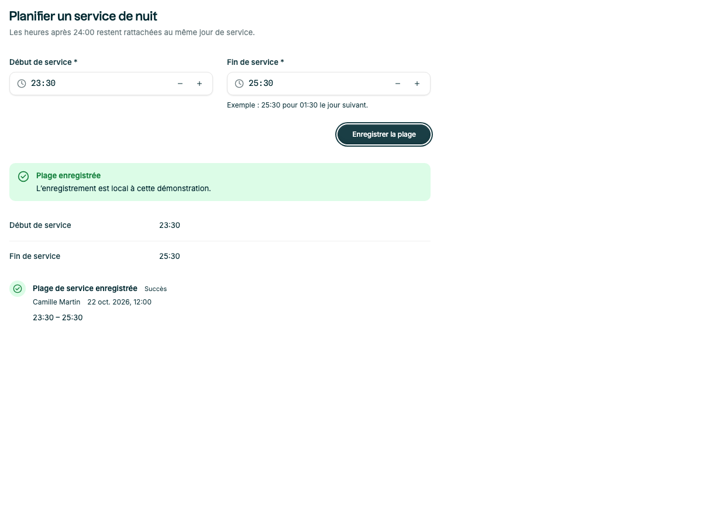

# Compléments avant 1.0 — 22 octobre 2026

Statut : implémenté dans la branche de travail `feat/additional-components`, à la demande de compléter le catalogue avant 1.0. Manifeste maintenu en 0.5.0 ; aucune publication.

## Choix

| Composant | Besoin couvert | Pourquoi le standardiser maintenant |
|---|---|---|
| `ErrorSummary` | Erreurs après soumission, accès aux champs | Centraliser le focus et la résolution de cibles, y compris une zone de dépôt ; éviter de répéter cette logique par formulaire |
| `DescriptionList` | Métadonnées d'un détail et synthèse de vérification | Les deux compositions existaient déjà ; harmoniser densité, retour à la ligne, valeurs absentes et sémantique HTML |
| `ActivityFeed` | Historique de créations, changements et publications | Fournir un affichage daté cohérent avec état textuel, auteur, fuseau explicite et états de chargement/vide |
| `TimePicker` | Heure seule et service après minuit | Compléter `DatePicker withTime`, qui associe une date et une heure civile ; préserver les heures de service comme chaînes |

L'audit précédent recommandait de commencer le résumé d'erreurs et les métadonnées comme compositions. Ce lot les extrait après intégration dans les exemples, avec un contrat commun testé. Il n'ajoute ni un deuxième sélecteur multiple (`Autocomplete multiple` existe), ni un second dialogue de confirmation (`Modal` existe).

## Intégration

- Import réseau : `ErrorSummary` et `DescriptionList` remplacent les assemblages locaux.
- Détail d'une perturbation : `DescriptionList` et historique `ActivityFeed` dans un panneau dépliable.
- Nouvelle recette « Planification de service » : validation d'une plage nocturne avec deux `TimePicker`, accès aux champs fautifs, synthèse et historique local après enregistrement.
- Les quatre composants sont exportés depuis `src/components/index.ts`, disposent de CSS propres et utilisent les tokens et composants existants. Aucune dépendance ajoutée.

## Limites assumées

- L'app calcule ses erreurs ; le résumé ne valide pas les champs. Les soumissions répétées peuvent focaliser sa ref explicitement.
- L'app fournit et autorise les événements de l'historique, dans l'ordre voulu. Aucun journal serveur, polling ou tri implicite.
- L'app fournit un fuseau IANA valide à `ActivityFeed` ; UTC est le défaut stable serveur/client.
- Les valeurs de `DescriptionList` sont formatées par l'app. Les valeurs absentes affichent « Non renseigné » par défaut ; 0 et les booléens sont préservés.
- `TimePicker` traite une heure sans fuseau, avec un mode optionnel jusqu'à 47:59. Cette limite est un choix d'API, pas une promesse de couvrir tous les formats d'échange. Les saisies invalides ne remplacent pas la dernière valeur valide ; la validité HTML bloque la soumission standard. Dans un formulaire `noValidate`, l'app appelle `checkValidity()` avant de lire les valeurs contrôlées.
- La Timeline de périodes reste reportée. Les interactions de zoom, chevauchement et sélection demandent un périmètre produit précis.

Les contrats complets et les exemples sont dans `GUIDELINES.md` et Storybook.

## Vérifications finales

- **651 tests réussis**, 91 fichiers : 269 tests unitaires et 382 tests de stories Chromium.
- `npx tsc -b --noEmit` : réussi.
- ESLint ciblé sur les quatre composants, leurs stories/utilitaires, les recettes et les primitives de surcouche modifiées : aucune erreur ni avertissement.
- Builds bibliothèque et Storybook : réussis. Le catalogue conserve son avertissement de taille de chunks.
- Les quatre exports et déclarations sont présents ; chargement ESM et CommonJS vérifié.
- `npm pack --dry-run` : 113 fichiers, environ 555 Ko compressés ; pas de fichiers de test/story, de dépendances installées ou d'environnement embarqués.
- Inspection visuelle 1200×900 et 360×900 ; absence de débordement sur la planification, une métadonnée longue et l'historique. Une infobulle des actions d'heure débordait initialement : elle est maintenant ancrée vers l'intérieur du champ.
- Régression en modale : Échap annule d'abord le brouillon de l'heure ; un nouvel Échap ferme la modale et rend le focus au déclencheur. Les primitives Modal/Drawer traitent désormais Échap après le contrôle actif, en respectant son annulation de l'événement. Les tests existants des surcouches passent.

