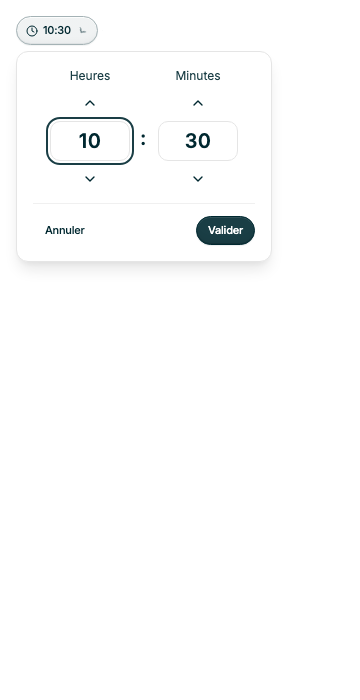
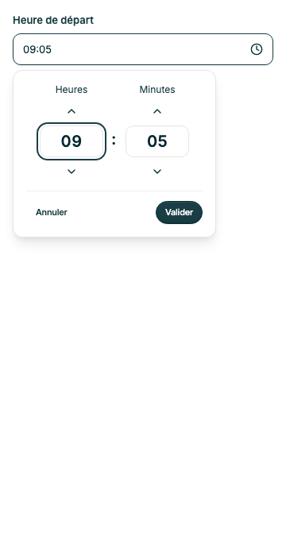

# Refonte du TimePicker — 22 octobre 2026

Demande : reprendre le module Date & Time de DatePicker, conserver l’écriture au clavier et proposer une variante bouton.

## Réalisation

- Module interne partagé `TimeFields.tsx` / `time-fields.css` : cases Heures/Minutes et flèches verticales. DatePicker conserve son fonctionnement date + heure ; TimePicker active la saisie dans ces cases.
- Variante champ : saisie des deux unités, normalisation sur Entrée ou sortie de l’éditeur, flèches bornées par unité, collage HH:mm dans l’une des cases.
- Variante bouton : déclencheur outline sm commun aux autres pickers, panneau horaire avec Annuler/Valider ; aucune valeur publiée avant validation. Échap, clic extérieur et sortie au clavier annulent le brouillon.
- Valeurs nocturnes jusqu’à 47:59, min/max, pas de minutes, erreurs métier, disabled et required conservés.
- Validité native : la case des heures porte la validité de l’heure complète. Une soumission invalide en variante bouton ouvre le panneau ; les champs restent montés quand il est fermé.

## Migration et limites

API complète actualisée dans `GUIDELINES.md`. Nouvelles props `variant` et `aria-label`. `label` reste recommandé pour un formulaire et peut être omis en variante bouton au profit d’aria-label.

La ref et l’id ciblent désormais la case des heures ; les tests doivent cibler « Heures — Nom » et « Minutes — Nom ». Pour focaliser un TimePicker bouton fermé depuis ErrorSummary, utiliser une cible conteneur incluant le déclencheur. Dans un formulaire noValidate, vérifier checkValidity avant d’utiliser la dernière valeur contrôlée.

Le module partagé n’est pas un export public. Aucune dépendance ajoutée. Le mode nocturne reste indépendant des dates, fuseaux et changements d’heure.

## Vérification

22 tests ciblés réussis sur TimePicker, DatePicker et la recette de planification : clavier, collage, limites, passage après minuit, heure facultative/obligatoire, annulation dans une modale, validation du bouton et soumission native.

Inspection mobile 360 px des deux variantes : aucun débordement de page. Les stories TimePicker imposent les contrôles d’accessibilité automatisés.

Validation finale : **667 tests réussis dans 94 fichiers**, TypeScript et lint ciblé réussis, builds bibliothèque et Storybook réussis. Les avertissements historiques de dépréciation et de champs contrôlés subsistent dans les exemples antérieurs.

## Ajustement demandé : champ compact et panneau à l’ouverture

La variante champ affiche désormais un déclencheur de 40 px avec l’heure et l’icône horloge. Comme DatePicker, ce champ ouvre un panneau ancré ; l’éditeur n’est plus exposé directement dans la page. Les deux variantes partagent le même panneau et le même cycle de brouillon/validation/annulation. La saisie et le collage clavier restent disponibles dans les deux cases du panneau.

Le label visible cible le déclencheur. La ref reste la case des heures pour le contrôle de validité ; une cible conteneur permet à ErrorSummary de focaliser le déclencheur fermé. La recette de planification a été adaptée en conséquence. Les captures initiales plus haut illustrent l’étape précédente ; voir `field-closed.png` et `field-open.png` dans le même dossier d’assets pour le rendu courant.

Validation après cet ajustement : **667 tests réussis dans 94 fichiers**, dont 13 tests ciblés TimePicker/planification ; TypeScript, lint ciblé, builds bibliothèque et Storybook réussis. Vérification visuelle du champ fermé puis ouvert à 360 px : aucun débordement.

