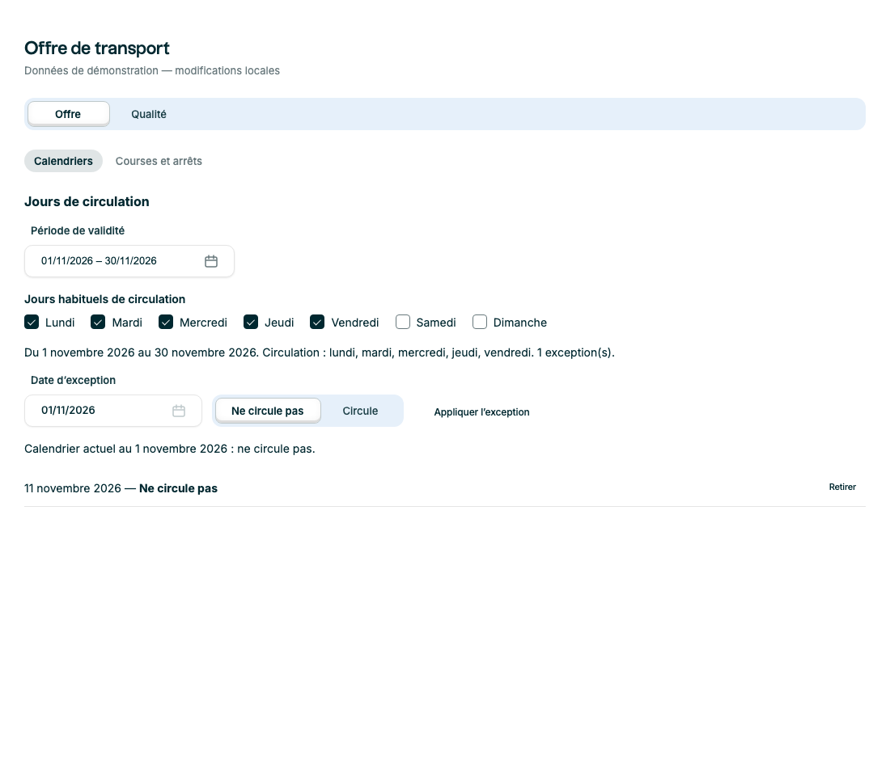
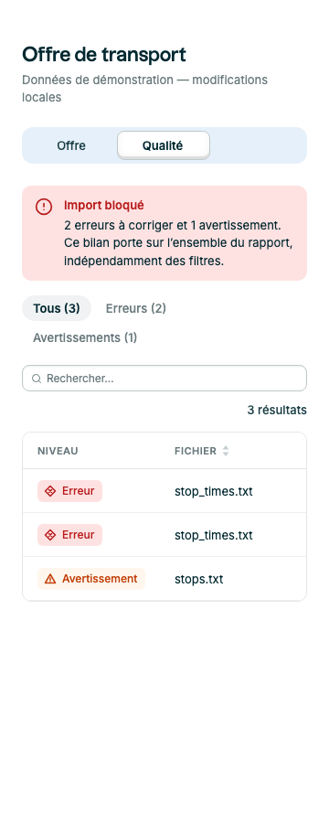

# Premier lot métier transport — 22 octobre 2026

Statut : implémenté localement sur `feat/additional-components`, version 0.5.0 conservée.

## Périmètre livré

Deux composants exportés : **ServiceCalendar** et **RouteStopList**. Un rapport **DataQualityReport** reste une composition interne à la recette `OffreEtQualite.stories.tsx`, conformément à la proposition de commencer par une recette avant d’extraire une API métier plus large.

- Calendrier : période, semaine type, exceptions uniques par date, remplacement et retrait, aperçu de circulation, contrôles désactivés et signalement des exceptions hors période.
- Course : passages ordonnés, horaires conservés après minuit, origine/terminus, arrêts non desservis, boucles avec identifiant de passage distinct, action de détail, chargement et état vide.
- Rapport : bilan global indépendant des filtres, recherche, erreurs/avertissements, tableau, détail du fichier/ligne/champ et correction attendue. La recherche sans résultat ne masque pas le fait que l’import reste bloqué.
- Parcours : SegmentedControl « Offre / Qualité », puis SecondaryTab pour les sous-vues. Les exemples utilisent uniquement des données locales.

## Contrats et limites

Les fiches API complètes sont dans `GUIDELINES.md`. Le calendrier utilise des dates civiles YYYY-MM-DD ; aucune déduction des jours fériés, conversion UTC, fréquence ou validation complète GTFS. L’application reste responsable de la validation avant enregistrement. Les exceptions devenues hors période restent visibles et ne sont pas supprimées silencieusement.

La liste d’arrêts affiche les horaires fournis sans les valider ni calculer de retard. Le rapport qualité ne lit et n’analyse aucun fichier ; les constats sont des données de démonstration. Aucune dépendance ni requête réseau ajoutée.

`DisruptionScopePicker`, `ScheduleComparison` et `DataFreshness` restent des propositions pour un lot suivant ; ils ne sont pas implémentés par ce premier lot.

## Validation

- Suite globale : **663 tests réussis dans 94 fichiers**.
- 15 tests ciblés : 5 tests des règles de calendrier et 10 stories navigateur. Relancés après le remplacement du bouton de retrait par un libellé visible pour corriger un débordement d’infobulle sur mobile.
- TypeScript, lint ciblé, builds bibliothèque et Storybook.
- Toutes les nouvelles stories imposent les contrôles automatisés d’accessibilité (`a11y.test: error`).
- Inspection visuelle à 1100 px et 360 px ; pas de débordement de page sur calendrier, arrêts et qualité après correction. Le tableau conserve son défilement horizontal interne sur mobile. Pas d’erreur JavaScript relevée pendant le parcours visuel.
- Les anciens avertissements de dépréciation et de champs contrôlés sans onChange restent présents dans la suite globale.

## Captures

